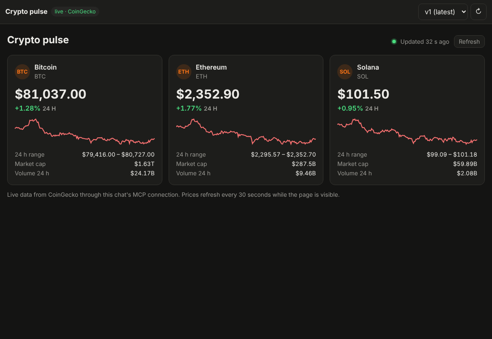
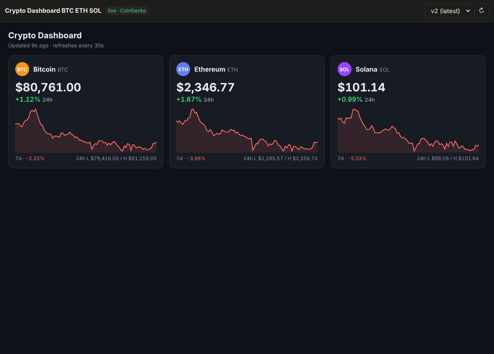

# pi-artifacts

A small reimplementation of Claude's artifacts on Cloudflare: chat with a [Pi](https://developers.cloudflare.com/agents/harnesses/pi/)
agent that builds **live dashboards**, preview them beside the chat, and share them by link. A published page pulls
**real-time data from MCP servers** each time someone views it, the way
[Claude's artifacts call MCP connectors](https://code.claude.com/docs/en/artifacts#pull-live-data-with-mcp-connectors).

- **Pi Durable** runs the agent inside a Durable Object, one per chat, and survives evictions mid-turn.
- **Durable Objects** hold each chat (agent, MCP connections, live calls) and each user's index of chats and artifacts.
- **Sandbox** (a Linux container per chat) runs the Python the agent writes, with no internet.
- **[Artifacts](https://developers.cloudflare.com/artifacts/)** keeps each published artifact as a Git repo: one commit
  and tag per version.
- **R2** keeps each user's files, which the agent reads and writes, plus a read cache of artifact versions.
- **The demo MCP server is [CoinGecko's public one](https://mcp.api.coingecko.com/mcp)**: free, keyless, live crypto market data.



## How live data works

The page never talks to the network. Its CSP is `connect-src 'none'`. It calls `pi.use("mcp")`, and every call travels
to **the same MCP connection the agent used to build it**:

```
artifact page (sandboxed iframe, opaque origin)
  │  mcp.watchTool("CoinGecko", "execute", {code}, onEvent, {refetchInterval: 30_000})
  ▼  MessagePort, handed over once, in answer to the page's hello
viewer page: ArtifactBroker (src/artifact/broker.ts)
  │  caches, groups identical watches, pauses while the tab is hidden, polls on the server's hint
  ▼  POST /api/artifacts/:id/mcp  {version, mode, server, tool, input, staleMs}
Worker: finds the artifact's chat
  ├─ a read the chat already allowed, with a young enough result? served here, the chat stays asleep
  ▼  RPC
ChatAgent Durable Object (worker/chat-agent.ts)
  ├─ is (server, tool) in this version's manifest?      no → not_in_manifest
  ├─ read-only tool? cache + one shared request in flight (McpHub.read)
  ├─ a write? only the page's author may call it          no → not_granted
  └─ McpHub ─► MCP server (no model involved: deterministic, quick, no tokens)
```

**The manifest.** When the agent publishes, it declares the servers and tools the page may call
(`[{server: "CoinGecko", tools: ["execute"]}]`). Publishing checks those names against the server's real tool list and
refuses a mismatch. Each version keeps its own manifest; a page cannot widen it.

**Whose connection.** Calls use the chat's MCP connections, so they run as the page's author. Claude's artifacts use
each viewer's own connectors instead. Two things follow from that:

- Sharing a page shares the data its manifest allows.
- Tools that are not marked `readOnlyHint` are refused for everyone but the author, are never cached and cannot be
  watched.

CoinGecko needs no sign-in. A server can also require each user's own; see [MCP servers, and servers that need your own sign-in](#mcp-servers-and-servers-that-need-your-own-sign-in).

**Polling with a server hint.** Every response carries `nextRefreshAt`: when the Durable Object's copy goes stale.

- The viewer asks again 0.25–1.25 s after that time, so it shows a new upstream result within about a second of the
  Durable Object fetching it. That is as fresh as WebSocket push would be, without the sockets.
- `refetchInterval` has a 30 s floor, as at Claude.
- Pages call as their author, so every viewer gets the same answer, and by default they share one cached result per
  call (`cacheScope` in `worker/mcp/servers.ts`; `"viewer"` keeps each viewer's results apart).
- The Worker keeps those shared results too (`worker/artifacts/page-calls.ts`), keyed by chat, server, tool and input,
  so a read that is young enough for the page (its `staleMs`) is answered without waking the chat's
  Durable Object, and identical reads that miss share one call to it. It serves a result only to a page version the
  chat allowed that read in the last minute, never for `auth: "oauth"` servers (they load only for people in the
  chat, which only the chat can check), and never for writes or uncached `callTool`s. Each Worker isolate keeps its
  own copy (8 MB at most), so 1,000 people watching one dashboard cost about one chat call per interval per isolate,
  not 1,000. (The Workers Cache API would share across a data center, but it is not available on workers.dev or
  behind Cloudflare Access.)
- While the viewer's tab is hidden, watches stop polling (a page opened in a background tab waits for its first
  fetch too) and `callTool`s of read-only tools wait; identical waiting calls go out as one when the tab returns.
- A chat keeps at most 16 MB of cached results. Expired entries go first, then the oldest; a single result larger than
  that is passed on but not cached.
- Each viewer may make 120 calls a minute through the pages of one chat, counted by the Workers rate-limit binding `PAGE_CALLS`
  across every Worker instance. Past that the proxy answers `rate_limited`, and the viewer waits 30 s before asking again.

Measured against CoinGecko:

- One `execute` call takes 0.6–0.9 s.
- The prices it returns are already 18–32 s old.

So upstream freshness, not the transport, sets how live the page can be.

## MCP servers, and servers that need your own sign-in

The app is agnostic of what its MCP servers do. The server list is a list of names and URLs, nothing more, and each
deployment keeps its own out of the repository. `cloudflare.config.ts` reads it, in this order:
1. `PI_MCP_SERVERS`, as JSON, if set;
2. otherwise `mcp-servers.json`, which is gitignored (copy `mcp-servers.example.json`);
3. otherwise the public demo server alone.

```json
[
  { "name": "CoinGecko", "url": "https://mcp.api.coingecko.com/mcp" },
  { "name": "portal", "url": "https://mcp.example.com/mcp", "auth": "oauth" }
]
```

The last entry is a Cloudflare MCP portal.

- **What the agent knows** comes only from the servers: their tool lists, and the instructions a server sends when it
  connects. You say in chat which server or tools to use ("use the reports server's run_query for…"). Otherwise the agent picks by
  the tool descriptions.
- **A Cloudflare MCP portal is one entry** for every server behind it. Its tools come namespaced (`reports_run_query`),
  and its own `portal_*` tools are left in. Through them, the agent can list the portal's servers and turn them on,
  and the portal can answer with a link for signing in to one of them. Add a server to the portal and it reaches the
  agent without a change here: no server behind a portal is named in the code or the config.
- **Discovery** happens when a chat starts and before every prompt, and tool lists are listed again after five
  minutes, so servers added to a portal show up on their own. Asked "what's available?", or told you just signed in,
  the agent calls `mcp_discover`, which lists every server afresh and installs any new tools at once, in the same turn.

`auth: "oauth"` means each user signs in themselves, and their chats call with their own tokens. The app is a standard
MCP OAuth client for it (`worker/mcp/oauth.ts`, on the MCP SDK): discovery, dynamic client registration, PKCE and
refresh. There is nothing specific to any one server:

1. Until you sign in, the server's tools are missing. The agent's prompt names the server as unavailable, with a
   sign-in link such as `/api/mcp/sign-in/portal` (a path in this app, so it needs no knowledge of the app's address), and the agent passes the link on when you ask for it.
2. The link starts the flow and redirects to the server's sign-in. For a Cloudflare MCP portal, that means Cloudflare
   Access, then the portal's page where you select **Connect** for each server that needs your own login and sign in
   to its identity provider. The portal keeps those sessions; the app never sees them.
3. The browser comes back to `/api/mcp/oauth/callback`. The Worker checks the `state` against the sign-in it started
   for *you* (the callback needs your app session too), exchanges the code and stores your tokens. Ask again in the
   chat: your next prompt picks up the server's tools (and `mcp_discover` picks them up within a turn).

Where things live and who can use them:

- **Tokens are per user,** in your `UserDirectory` Durable Object, which only requests carrying your verified identity
  reach. All your chats share them. Each record is encrypted with AES-GCM under a key of your own, derived from
  `MCP_TOKENS_KEY` (or, without it, from `FILES_MASTER_KEY` under a label of its own) with your uid, and bound to the
  server's name (`worker/mcp/sealed.ts`). A copy of the storage alone reads nothing. Records stored before this are
  sealed the first time they are read.
- **When a sign-in lapses,** the SDK refreshes it. If it can't, calls fail with `auth_required`, and the message
  carries the sign-in link.
- **Two chats refreshing at once don't undo each other.** Each change to the stored record (new tokens, a cleared
  verifier) is applied inside the `UserDirectory` in one step, and a rejected refresh clears the tokens only if they
  are still the ones that chat used.
- **Pages that call such a server load only for people in their author's chat** (the author, and anyone they invited
  into it; see [Shared chats](#shared-chats)). A page calls through its author's chat, so it would otherwise show the
  author's data to anyone with the link. Other viewers get `not_granted`, and the page's tool list leaves that server's
  tools out for them. Claude's artifacts instead use each viewer's own connectors.
- **Removing a server** from the list also removes everyone's stored sign-in for it, tokens included. This happens the
  next time each user's directory loads.
- **Signing out:** a new sign-in replaces your tokens once it finishes; starting one (anyone can link to the sign-in route) changes nothing until then.
  **Sign-ins** in the account menu lists each such server with when you signed in, and **Disconnect** deletes the
  stored record, tokens and registration. To end the portal's own session, sign out on the portal's home page.

`test/mcp-oauth.test.ts` runs the whole flow against a stand-in portal:
- a sign-in;
- two users kept apart;
- a forged `state` refused;
- refresh on expiry;
- `auth_required` when refresh fails, leaving an open sign-in untouched;
- the check before a scheduled run: `ok` after a refresh, `needs_sign_in` when the refresh is refused, `unavailable`
  when the server does not answer.

### Sign-ins with nobody present

An agent's scheduled runs use your sign-ins while you are away (`worker/mcp/background.ts`, `worker/mcp/sign-ins.ts`):

- **Before a run** the app refreshes each sign-in it needs (`UserDirectory.checkSignIns`): per server `ok`,
  `needs_sign_in` or `unavailable`. A run with `needs_sign_in` does not start. You get a notice with the sign-in link in
  the sidebar, as a browser notification, and as a push when the app is closed (once until you sign in). After the
  sign-in callback, each chat with a run waiting hears it (`UserDirectory.onSignedIn` → `ChatAgent.signedIn`), so the
  run can go again.
- **How long a sign-in lasts** is not something Access or OAuth says, so the app counts it from the sign-in:
  `MCP_GRANT_DAYS` (default 30) should match the grant session duration of the portal's Access application. Three days
  before it ends (a tenth of a grant shorter than 30 days), you get one warning per sign-in. A sign-in a refresh cannot
  renew ends there: it shows as signed out until you sign in again.
- **Keep-alive:** sign-ins that runs use are refreshed about once a day, in case the authorization server ends a
  session idle for 24 hours.
- **Runs only read:** the helpers for the run code, `readOnlyTools` and `assertReadOnly`, offer a run only the tools a
  server marks read-only and refuse any other call before it reaches the server.
- **The refresh token is the real credential:** 2FA protects a new sign-in, not a refresh. Access checks its Allow
  policy again on every refresh, so removing someone from it ends their runs' access at the next refresh.

### Push notifications

With the VAPID secrets set, the app also reaches people while it is closed (Web Push, `worker/push/`): RFC 8291
payload encryption and an RFC 8292 VAPID token, with WebCrypto alone. Turning on notifications in the app subscribes
the browser (a service worker, `public/sw.js`); a push goes out only when none of the user's apps is open, says only
that something arrived (never its content), and opens the chat when clicked. Its topic (which the push service sees) is
an HMAC of the notice's tag, not the tag. A subscription the browser replaces while the app is closed is handed to the
Worker by the service worker. A subscription belongs to the user signed
in when it was made: signing out ends it, and a browser where another user signs in next gets a new one. Endpoints are taken only at the known push
services, and ones a push service reports gone are forgotten. Other code sends one with `UserDirectory.push({ title,
body, url, tag })`. Without the secrets nothing is pushed and the rest works as before.

Locally, `PI_MCP_SERVERS='[…]' pnpm dev` uses another list, for example with a local stand-in portal.

Setting up a Cloudflare MCP portal for it (Zero Trust → Access controls → MCP Portals):

- The portal needs its own hostname, a subdomain of a zone in the account. On the bare domain of a site that already
  exists, `/mcp` reaches the site instead.
- The hostname needs a proxied CNAME to `gateway.agents.cloudflare.com`. The dashboard adds it when it creates a
  portal; changing the hostname later, the API and Terraform do not, and the portal's address then does not resolve.
- The portal's Access application and each of its servers' need an Allow policy listing who may use them. Without
  one, nobody can sign in.
- Keep **Require user auth** on for servers whose data depends on who asks: that is what makes each person sign in
  with their own account.
- Put the portal's `/mcp` address in `mcp-servers.json` with `"auth": "oauth"`. When you deploy from a fresh checkout
  (a cloud session, CI), set `PI_MCP_SERVERS` in that environment instead: without either, a deploy falls back to the
  demo server alone and the agent no longer sees the portal.

## The page runtime

`runtime/pi-runtime.js` is inlined at the top of every published page. It mirrors the shape of Claude's
`window.claude.use("mcp")`, so a model that knows one writes the other. `runtime/runtime.d.ts` is the contract, and the
agent reads it in its system prompt.

```js
const mcp = await pi.use("mcp");                    // null outside a viewer: render a static fallback
const stop = mcp.watchTool("CoinGecko", "execute", { code }, (ev) => {
  if (ev.type === "data") render(ev.result.payload, ev.result.cache?.storedAt);
  else showSectionError(ev.error.code);             // server_unavailable, not_in_manifest, tool_error, …
}, { refetchInterval: 30_000 });

const docs = await mcp.CoinGecko.search_docs({ query: "markets" });   // one-shot call, resolves to the payload
await mcp.invalidate("CoinGecko");                                    // refetch now
```

[`examples/crypto-dashboard.html`](examples/crypto-dashboard.html) is a complete page written against it.

### Saved layouts and typed edits

A page can also keep what each viewer changes, and ask a small model about what they type into it:

```js
const store = await pi.use("storage");      // this viewer's values over the author's; sync reads after this
const layout = JSON.parse(store.getItem("layout") ?? "null") ?? DEFAULT;
store.setItem("layout", JSON.stringify(next));   // saved in the background
await store.reset();                         // back to the author's layout

const ai = await pi.use("ai");
const { json } = await ai.complete({ system: "Cards: … Reply with {order, hidden}.", messages: [{ role: "user", content: typed }], json: true });
```

- **Storage** is kept per viewer and page in the viewer's `UserDirectory` (`page_values`). The author's own values are
  everyone's defaults: a viewer sees the author's layout until they change it, and a key they remove stays removed for
  them. Nobody but the author changes the defaults, and everyone who opens the page reads them, so pages must not save
  data from MCP calls there. The frame's opaque origin has no `localStorage`; the runtime puts the same store in its
  place, so libraries that save their state there keep it. Limits: 500 keys and 500 000 characters per viewer and page.
- **The model** (`PAGE_AI_MODEL`, by default gpt-oss-120b on Workers AI, then Gemini Flash-Lite) answers one request
  at a time, with no tools. The person typing pays: each call counts against their own daily allowance
  (`PAGE_AI_DAILY_USD`, kept in their `UserDirectory`), 20 calls a minute at most (`PAGE_AI`).

| The author's layout, everyone's default | Another viewer's own order, over it |
| --- | --- |
|  |  |

## Checking a page before it is published

The agent checks every page in a headless browser (Cloudflare Browser Rendering, the `BROWSER` binding) before it
becomes a version, so the versions a user sees are pages that rendered without errors, and fixes along the way use up
none. The agent writes a page with `artifact_write`, which saves it as a draft (below) and returns its id; it then checks
and publishes that draft by its id, so the page is written out once. `artifact_check` (`worker/artifacts/check.ts`)
renders the draft as a viewer would: in a sandboxed frame under the
page's CSP, with its live calls answered by the chat's MCP connections. It returns:

- **errors:** uncaught exceptions and unhandled rejections (their lines mapped back to the page's own), `console.error`
  calls, loads the CSP blocked or that failed, live calls the page got wrong (`not_in_manifest`, `bad_request`,
  `tool_error`), a script error the page caught and only showed on screen ("L.map is not a function"), a page that shows
  nothing, and failed tests;
- **warnings:** `console.warn`, calls that failed for reasons outside the page (sign-in, an upstream outage, limits),
  and text such as `NaN` or `undefined` on screen;
- how each live call went, the page's visible text, and a **screenshot**, which the model looks at (and the chat's step
  panel shows as a thumbnail);
- the results of **tests** the agent passes: short scripts run in the page once its data arrived, such as "the price
  table has rows".

A check that found no errors also gets a **look at its screenshot** (`worker/artifacts/look.ts`): a vision classifier on
Workers AI (TypeSafe's Jev by default, `CHECK_LOOK_MODEL`, run through the `AI` binding with no key) answers whether the
page shows its content, or looks blank, shows an error, is stuck loading or is broken. It catches what only shows in the
picture, such as text the same colour as its background or a chart that drew nothing. A sure "blank", or a sure "error"
when no live call failed outside the page, is an error; anything else it sees is a warning. Since a model can be wrong,
it stops a draft only once: checked again unchanged, after the agent looked at the screenshot, its finding is a warning.
The look answers without writing text (input priced only) and its spend counts in the chat's cost panel; when it fails
or takes over 6 s, the check goes on without it. An empty `CHECK_LOOK_MODEL` turns it off.

A page's first check also gets a **code review** (`worker/artifacts/review.ts`), like the review pass run on the app's
own code: a small, cheap model (`REVIEW_MODEL`, by default gpt-oss-120b on Workers AI, then Gemini Flash-Lite) reads the
page's source, with line numbers, beside the browser check, so it adds no time unless it is the slower of the two. It
looks for bugs, security holes (untrusted text from MCP calls, storage or `pi.use("ai")` put into `innerHTML` unescaped,
MCP data saved to storage, where every viewer reads the author's values), work that never ends (polling without an end,
`pi.use("ai")` on load or on a timer) and simpler code. What it says to fix is an error, so the agent fixes it with
edits before publishing; a suggestion is a warning. The review is bounded to one round: a draft edited from a reviewed
one is not reviewed again, and a draft it stopped passes when checked again unchanged, since the reviewer can be wrong.
When it fails or takes over 45 s, the check goes on without it. The chat shows it as a step of its own under the check,
and its spend in the cost panel ("Page code reviews"). An empty `REVIEW_MODEL` turns it off.

A draft that passes is published by its `draft_id`. A publish without an `artifact_id` goes to the artifact the draft was
written for, else to the chat's artifact whose title matches (`new_artifact: true` makes a separate one), so a fix the
model publishes without the id never turns into a second artifact stuck at version 1. `artifact_publish` takes only a
draft that passed its check.

Until a page passes, it is a **draft**, not a version: every page the agent writes is saved as one of its chat's drafts
(`worker/storage/drafts.ts`), so no attempt is lost and the Git repo only ever gets pages that passed. Drafts live in
the chat owner's R2 folder (`users/<uid>/drafts/<chatId>/`), encrypted with the owner's key like their files but apart
from them, keyed by a hash of the page and what it declares, so the same page is one draft. A chat keeps its newest 20;
publishing a page drops its draft, and deleting the chat deletes them all. To fix a page, or to change a published one,
the agent sends `artifact_write` a `draft_id` (or the `artifact_id`, for its latest version or `version`) and `edits` (text replaced
exactly once each), so a fix costs the model only what changes, not the whole page again. Right after a check found
errors, `artifact_write` refuses the first whole new page, telling the model to fix the draft by edits. The agent lists drafts and
gets one back with `artifact_drafts` (an earlier attempt, or the page it was working on after the chat restarted).

A check has hard limits, so it never holds a run: the browser gets 30 s to start, the whole check 60 s (loading and
settling at most 15 s, the agent's tests 20 s together), and a page that holds the browser past that, such as one stuck
in a loop, gets an error for it while its browser is dropped. Stopping the chat ends a running check. After 5 checks in
a row with errors the agent stops fixing and tells the user what still fails; their next message lets it go on.

During a check only read-only tools run, from results up to two minutes old; a write tool answers `not_granted`. The
browser may reach only the page's script hosts and Google Fonts. When no browser can check a page (none bound, or one
that fails to start), the page is not published: it stays a draft, and the agent says so. Only local development
(`AUTH_MODE=demo`) publishes it unchecked. `pnpm dev` runs a local Chrome, which miniflare downloads.

## Your files

Upload from the sidebar (several files, or a whole folder) or drop files and folders anywhere on the app. Uploads land
in `uploads/`, a folder keeping its layout (`reports/q3/sales.csv` is `uploads/reports/q3/sales.csv`); files and folders
whose names start with a dot (`.git`, `.DS_Store`) are left out of a folder. A file may be up to 10 MB; the app splits a
big pick into requests of at most 50 files and 40 MB (`shared/uploads.ts`, `worker/files-routes.ts`).

Your files sit in a panel at the bottom of the sidebar that opens and closes (artifacts and the skills link sit just above it, and only chats scroll above them; a long artifact list scrolls on its own). An image's name
opens it in a new tab, and every file and folder has a download button. A folder
downloads as a zip named after it with the folder itself at its root (`q3.zip` holds `q3/sales.csv`, `q3/2024/…`),
streamed by the Worker and stored uncompressed (`worker/zip.ts`), up to 1 GB and 2,000 files. Files are served with
`nosniff`, a sandboxing CSP and `Cross-Origin-Resource-Policy: same-origin`; only raster images and SVG open in the
browser (an SVG's scripts stay off under the sandbox), anything else only downloads.

The panel's search filters the tree by path. **Select** picks files and folders to download together: one zip named
after the folder holding them all, with that folder at its root (`files.zip` with the top folders when they share
none), posted as a form into a hidden frame (`POST /api/files/zip/`), which shows the Worker's reason when it refuses.

Before each message, the agent's prompt gets a list of your files, newest first (at most 150, then a count per folder),
so "the sales file from q3" maps to its path without a tool call. `files_read`, `run_python` and `run_bash` also take a
file's name or the end of its path when only one file matches, and answer with the candidates when several do
(`worker/agent/file-refs.ts`). The list changes the system prompt only when your files change.

### Attachments

Files can also go with a message: attach them with **+** next to the message box, paste an image, or drop files on the
message box (at most 10 per message). They are uploaded to the chat owner's `uploads/` (the agent acts as the owner, so
in a shared chat a member's attachments go there too), and the model gets their content with the message, each
introduced by its path (`worker/agent/attachments.ts`, `shared/attachments.ts`):

- **Images** (JPEG, PNG, GIF, WebP, and anything else the browser decodes, re-encoded as JPEG) as images. The browser
  scales them to at most 1568 px and a share of 1.1 MB of base64 per message, since a message is one transcript row
  (2 MB at most), and sends a thumbnail the transcript shows. The Worker never decodes an image. A model without
  vision gets pi-ai's placeholder instead; the model picker says so when images are attached.
- **Text files** (by extension) as their text, up to 100 000 characters each and 150 000 per message, cut with a note
  pointing at the whole file.
- **PDFs and office documents** as Markdown from Workers AI's `toMarkdown` (free for these formats).
- **Anything else** by name only, for `files_read` and the sandbox.

The chat's sockets send the transcript without image data (the thumbnails stand in), so a chat full of images still
opens quickly.

## The sandbox

`run_python` and `run_bash` run in one Linux container per chat (`worker/sandbox.ts`, the Sandbox SDK's container
in a Durable Object). It runs Debian with Python 3.13, pandas, numpy, the libraries skills' scripts commonly import (pypdf, pdfplumber,
reportlab, openpyxl, python-docx, python-pptx, pillow, matplotlib, pyyaml, jinja2, beautifulsoup4, lxml) and the usual command-line tools, and has no
internet. Each run is limited to 60 seconds. Files move like this:

- **In:** the agent names files from the user's files: paths, a file's name or the end of its path when only one file
  matches, or a folder for every file in it. The tool reads each one through the user's `UserFiles`, so R2 decrypts it
  with the user's key, and copies it into the container's `./files/` with the Sandbox SDK's file API, in its folders
  but without the leading `uploads/` (`uploads/q3/sales.csv` is `./files/q3/sales.csv`). Two files that would land on
  one path (`uploads/a.csv` and `a.csv`) refuse the run. One run takes at most 200 files and 25 MB (they reach the container in one RPC call, capped at 32 MiB).
- **Out:** after the run, whatever the script wrote to `./out/` (top level only) is read back from the container and
  saved through the same `UserFiles` as `out/<chatId>/<name>`, encrypted with the user's key. Each chat saves to its
  own folder, so two chats of one user running at once never overwrite each other's outputs; the agent is told to keep
  the files it writes with `files_write` there too.
- **Between runs:** `./files` and `./out` start empty each run. Anything else in the working directory stays until
  the container stops, 10 minutes after the last run.

The container never sees R2, the bucket or any key: only the bytes the Worker hands it.

## Skills

A skill tells the agent how to handle one kind of request: a **description** of when to use it, **instructions and
guardrails** to follow, and the **tools** it works with. Only the names and descriptions are in the system prompt; when
a request fits one, the agent calls `activate_skill` and gets the rest. Skills use the
[Agent Skills](https://agentskills.io) `SKILL.md` format (`name`, `description`, `allowed-tools`), served to Pi by
`skills()` from `agents/harness/pi`.

- **Built-in skills** ship as `SKILL.md` files in `worker/skills/builtin/`: `analyze-files` (questions about uploaded
  files, with `run_python`), `revise-artifact` (change a published page from its current version) and
  `explore-mcp-server` (learn a server with one small read-only call). Each user can turn them off.
- **Your own skills** are kept per user in `UserDirectory` and apply in all your chats. Write them, import a `SKILL.md`,
  download one, turn them on and off or delete them under **Skills** in the sidebar (`/skills`, API under
  `/api/skills`, in `worker/skills-routes.ts`). A change applies from the next message in any chat.
- **Skill packages**: **Import package** takes a zip (`.zip` or `.skill`) of a skill's folder, its `SKILL.md` and
  the files beside it (`POST /api/skills/import`, `application/zip`; at most 10 MB, 300 files, 2 MB each). Nothing in
  it runs on import. The files are kept encrypted in your R2 folder (`users/<uid>/skills/<name>/<set>/`,
  `worker/storage/skill-files.ts`), a new set per import, binary ones (images, fonts…) marked as such. The agent reads
  them with `read_skill_resource`, and a page uses one by reference: `<script src="skill:<name>/<path>"></script>`,
  `<link rel="stylesheet" href="skill:…">`, or as another attribute's whole value (``, an icon's
  `href`…). The draft keeps the
  reference and pins the set; the check and the publish put the file in its place (`shared/skill-files.ts`): a
  script's or stylesheet's text, any other file as a `data:` URL, and the fonts and images a skill stylesheet names by
  relative `url()` as `data:` URLs too. So a version holds everything it runs and never changes when the skill does,
  and what was checked is what is published. Reading a published page back (`artifact_read`, edits, diffs) shows the
  references again. A skill's scripts run in the sandbox: `run_python` and `run_bash` take `skills: ["<name>"]`,
  which copies the skill's folder (its `SKILL.md` and files) to `./skills/<name>/`; `/mnt/skills/{public,user}/`,
  `/mnt/user-data/outputs` and `/mnt/user-data/uploads` point at `./skills/`, `./out/` and `./files/`, so scripts
  written for those paths run as they are. A Claude Code skill's
  `allowed-tools` are read as written ("Bash(git:*)" is `Bash`), and the agent is told which tool here does each one's
  work (`Bash` → `run_bash`, `Read` → `files_read`, `Write`/`Edit` → `files_write`, `Glob`/`Grep` → `files_list`). A skill written for another host (copy `dist/`, supporting files,
  `/mnt/skills/…`, an outputs folder) works unchanged: the system prompt tells the agent what each means here.
- **The agent can propose a skill** with `skill_propose` when you ask it to ("save this as a skill"). A proposal is
  saved **off** and can replace only another proposal that is still off. Text from a tool result or a file therefore
  never becomes standing instructions in every chat until you have read it and turned it on.
- Built-in and user skills are kept apart: each kind has its own names and API paths (`/api/skills/builtin/:name` and
  `/api/skills/:name`), and the list labels each skill's source. A new skill cannot take a built-in's name, but a
  built-in added later can take one of yours: then the agent uses yours while it is on, and the list says so.
- The tool list is guidance shown on activation, not a sandbox: every tool of the chat stays callable.
- **Only the skills a chat needs are listed.** Before each message that starts a run, a System One classifier on
  Workers AI (`SKILLS_MODEL`, TypeSafe's Jev by default, through the AI binding) answers, for each enabled skill the
  chat does not list yet, whether the message needs it (one yes-or-no question per skill, from the message, the names
  of its attachments and the end of the conversation). Only those join the chat's list
  (`worker/agent/skill-pick.ts`). The list only grows: it is part of the system prompt and the tools, and the
  provider's prompt cache keeps the conversation only while they stay the same, so a chat the agent answered before
  the skills were picked keeps every skill it was shown. When the classifier fails or runs out
  of time, every skill it was asked about is listed, as before; an empty `SKILLS_MODEL` lists every enabled skill. Its
  calls count in the chat's AI cost ("Skill picks").

## Keeping model calls small

Every model call sends the whole conversation again, so most of what a chat costs is its context, read from the
provider's prompt cache or written to it again:

- **Context budget.** A conversation is summarized once it passes `CONTEXT_BUDGET` (160K tokens, `shared/models.ts`),
  whatever the model's window; the summary starts in the background 32K before that. With 1M-token windows, long
  page builds otherwise reached 400-740K tokens a call. The context meter fills up to that point.
- **Warm cache.** Claude keeps a prompt cache for 5 minutes after its last use; a later call writes the whole
  conversation again. `worker/cache-warmer.ts` sends a chat's last large Claude request again with `max_tokens: 0`
  every 4.5 minutes, until 15 minutes after its last call, which keeps the cache at the price of a cache read.
- **Smaller tool results.** MCP results go to the model as compact JSON, check screenshots at 1,280 px at most,
  `run_python`/`run_bash` output by its last 10,000 characters, and `artifact_read`/`artifact_drafts` can return
  part of a page (`part`: a line range or a piece of text).

## System prompts

You can add your own instructions to the agent's built-in system prompt, which they never replace:

- **Your own system prompt** (account menu, **System prompt**) applies in all your chats, the ones you share
  included. It is kept in your `UserDirectory` (`GET`/`PUT /api/me/system-prompt`), read again before every message.
- **A chat's system prompt** (the pen icon in the chat's header) adds to yours for that chat, and wins where the two
  disagree. Only the owner changes it; the people the chat is shared with can read it there
  (`GET`/`PUT /api/chats/:id/system-prompt`). It applies from the agent's next model request, a run going included.
- Both go after the built-in sections (`worker/agent/prompt.ts`, section `user_system_prompt`), up to 8,000 characters
  each, and the built-in rules for pages win over them: the page check and sandbox enforce those anyway.
- The agent's system prompt stays on the server: the chat's socket sends its `pi.system` entries without their
  sections and tools, so a member's browser never gets the owner's prompts, file list or MCP tools. That is hygiene,
  not a boundary: the agent acts as the owner and may tell anyone in the chat what it was told.

## Export and import

Everything you have can leave as one zip and come back, on the same deployment or another (account menu, **Export
data** and **Import data**). The browser builds the zip a piece at a time and reads one back the same way
(`src/data/`, routes in `worker/data-routes.ts`, format in `shared/data-export.ts`), so no request carries more than one
piece and the zip is not bound by what one Worker request may hold.

- **In it:** your own chats (each chat object's conversation, reactions and settings, `worker/chat-dump.ts`, and the
  pages its agent saved and did not publish), your artifacts with every version, your files, your skills with the files
  of those imported as packages, your system prompt, model pick and built-in skills turned off, what pages saved for
  you (`pi.use("storage")`), and the pages and agents you follow. An import follows each again only where you may
  open it, as following by hand checks (on the same deployment); the rest are skipped.
- **Not in it:** your sign-ins to MCP servers (tokens, which belong to the deployment), what pages' model calls cost you,
  your feed (it fills again from what you follow and what happens next),
  the chats others shared with you (listed by name only: they are their owners'), and the people in your shared chats
  and their invites: their ids mean nothing on another deployment, so an imported chat has only you in it. Their
  messages stay in its conversation, under their names. Work still running in a chat (a run, a queued message) is left
  out too, so nothing runs on import as you without being asked.
- **Ids:** your user id differs between deployments, so an import puts yours in place of the export's wherever a chat
  stores it. Chats keep their ids. An artifact keeps its id unless someone else's artifact has it on this deployment;
  then it gets one derived from your id and its old one, the same on every try, and chats that name it are changed to
  match.
- **Never over what is here:** a chat, artifact version, file or skill you have already is skipped, and settings are set
  only where you have none. An import that stopped part way is run again with the same zip and goes on: a chat becomes
  yours only once all of it is in.
- **Limits:** a plain zip (up to 4 GB and 65,535 files); one file of at most 95 MB per import request (Cloudflare takes
  100 MB in one).

## Shared chats

A chat's owner can invite other people to build artifacts with them in the same chat. Pi Durable is multiplayer for
people: many people share one conversation with one agent, and their messages queue in its inbox while it works.

- **The agent answers when called:** the agent is named `pi`. In a chat with members, only a message with `@pi` in it
  (typed, or picked first in the "@" list), or a reply to one of pi's answers, is a prompt; any other message is people
  talking among themselves. Such an aside is two passive pi writes: the `chat.message` entry everyone sees, with
  `aside: true` and no model message, lands at once even mid-run; a `chat.aside` entry carries it to the model as a
  user message, which pi places at once when idle, or at its next step while it works. So the model reads the talk as
  context when it is next called, and a run starts only for `@pi`. A message that called pi shows 👀 once its run
  picked it up, and pi's answers carry its name. A chat nobody shares works as before: every message is a prompt.
- **Spotting messages meant for pi:** an aside may still be for pi ("pi, can you…"). Once it is placed, a System One
  classifier on Workers AI (`CALL_HINT_MODEL`, TypeSafe's Jev by default, through the AI binding with no provider key)
  reads it with the end of the conversation and says how likely it is meant for pi (`worker/agent/call-hint.ts`). At
  0.7 or more, only its author's windows are told (`callHint`), and show "Meant for pi? Ask pi" under it: Ask pi
  replies to the message with `@pi`, which calls pi like any reply. The message itself stays an aside, nothing runs on
  its own, and a failed or slow call (past 4 s) shows nothing. Each call is in the chat's AI cost ("Spotting asks for
  pi"). The hint lives only in the open windows, and goes once pi has run since (it read the message then).
- **Tagging people:** "@" also offers the others in the chat; a pick puts `@name` in the text and sends the person's
  uid with the message, which the chat keeps only for someone in it. The tagged person sees the tag in their colour
  and the message marked; their sidebar shows "@" on the chat until they open it, and every app window they have open
  shows a notice that opens the chat (none in the chat they are looking at). While the app is in the background, the
  browser shows a notification too, once they allowed it with the bell in a shared chat's header (the notification's
  tag keeps it to one across windows). A tag is no call of pi. The notice goes over the sidebar's socket
  (`MentionNotice`, sent with the chat's bump: a `Tag` on `UserDirectory.touchChat`/`touchSharedChat`); with the app closed nothing is pushed, there is no service worker.
- **Filtering chats:** once a chat is shared, the sidebar's chat list can show all chats, private ones (the user's own,
  nobody else in them), or shared ones: both, those the user shared, or those shared with them. The chat open now
  always shows. The owner's directory learns which of their chats have members from the chat (`setChatShared`), on
  joins and leaves (a chat shared before that tells it once, when anyone in it next opens it).
- **Replies and copying:** any message can be answered (the reply quotes it, and the model reads `[Replying to name:
  "…"]`) or copied, as rich text and as plain text (Markdown for pi's answers).
- **Invite:** **Share** in the chat header makes a single-use link, `/join/<token>`, valid for 7 days. The token names
  the chat and carries a random secret; the chat keeps only the secret's SHA-256 hash, so the link is shown once.
  Whoever opens it, signed in, clicks **Join** and finds the chat in their sidebar; someone already in the chat (the
  owner trying their own link, or a member opening it again) just lands in it, and the link stays unused. The same
  person can have the chat open in several tabs or devices at once. The owner sees who is in the chat
  and the open links, removes people and revokes links; a member can leave. Only the owner invites.
- **One agent, acting as the owner:** a shared chat stays the owner's `ChatAgent`. Whoever writes, the agent works
  with the owner's MCP connections and sign-ins, files, sandbox and skills, and what it publishes belongs to the
  owner. The Share panel says so before the owner makes a link: members can ask it to read or change anything those
  reach.
- **Who wrote what:** each message is placed as a `chat.message` entry naming its author. Once the chat has members,
  the model reads it as `name: text` (before that, no name reaches the model), and a system-prompt section says who
  is in the chat.
- **Joining and leaving:** when someone joins, leaves or is removed, the chat writes a `chat.people` entry, and
  everyone sees a line like "bob joined the chat". Someone already in the chat who opens an invite link again (the
  owner trying their own, or a member in another window or on another device) shows as "joined again from another
  window or device"; a reload shows nothing. It is a passive pi write: placed at once, even mid-run, and the
  model never reads it.
- **Who is here now:** the header lists everyone in the chat, the owner and the members alike, each with their colour
  and a green dot while they have it open ("×2" when in two windows). Each open window is one chat socket, so the chat
  object counts them and tells every socket when one opens or closes. Each person's messages have their colour, the
  same in every window (by their place in the chat), and pi's have the accent colour.
- **What members see of the owner's:** the "@" list offers a member only the chat's files (attached in it, saved by
  its agent, or in its `out/<chatId>/` folder) and artifacts, and their own files; one of their own they name is
  copied into the owner's `uploads/` and attached to the message, as the agent works with the owner's files. The
  sidebar adds the chat's files and artifacts beside the member's own while the chat is open; the chat's files are
  served through `GET /api/chats/:id/files/<path>`, which the chat object checks. A member's message attaches only what
  they uploaded through the chat (which the chat object notes) or the chat's files; what a member uploads or brings
  goes beside an owner's file of the same name, never over it. The agent itself still reaches all
  of the owner's files, as the Share panel says.
- **Queued messages:** a message sent while the agent works waits in pi's inbox (`pi.inbox`). pi's event stream
  reports each change to the inbox by ids only, so the chat adds the waiting messages, read from the inbox, to that
  batch. Everyone sees them at once, faded and marked "Queued" (with "2 of 3" when more than one waits), below what
  the agent is doing. Each leaves the queue for the transcript
  when its turn comes. A failed run goes on to the messages behind it (`afterFailedRun: "continue"`), so one person's
  failed request does not hold the others'. **Stop** withdraws the queued messages too, as pi's abort does, and the
  others see who stopped pi.
- **Access:** the Worker finds the chat through the user's index (their own chats and the ones shared with them), and
  the chat object checks membership again on every socket and prompt, and on page calls to servers that sign in each
  user. Removing someone tells their sockets so and closes them at once (close code 4403), and the app stops reconnecting;
  the messages they left queued are withdrawn, so none runs as the owner after they are out.
- **Pages:** people in the chat may load its pages' data from servers that sign in each user, since they see that
  data in the conversation anyway. A page's write tools stay the author's only.
- Routes in `worker/chat-routes.ts`; members and invites in `worker/members.ts`, in the chat object's SQLite.

## Agents

Besides `pi`, a chat can hold agents of its owner's: each with its own name (called as `@name`), job line,
instructions, model and effort, and the MCP servers it may use.

- **Definitions** live in the owner's `UserDirectory` (`agents` table, `worker/agents/store.ts`), with routes under
  `/api/agents` (`worker/agents-routes.ts`). Each change counts the version up; a save that read an older version is
  refused. An agent pi proposes (`agent_propose`) is saved off until its owner turns it on, as skills are, and the model
  can never change or turn on an agent of the user's. An agent's name follows `AGENT_NAME_PATTERN` and can't be `pi`
  or a word for everyone.
- **In a chat**, the owner adds agents that are on (`POST /api/chats/:id/agents`). The chat keeps only a roster that
  points at definitions (`chat_agents`, `worker/agents/roster.ts`), and runs each agent in a pi session of its own in
  the chat object, set up afresh from its definition before each turn.
- **Who speaks:** a message that names agents with `@name` gives each a turn, in the order named; a reply to an agent's
  message gives it one too. Turns wait in a queue in the chat's SQLite (`chat_agent_turns`), one at a time per agent,
  and survive a restart: a turn whose input never reached its session starts again, and a turn ends with its reply kept
  in its row and its hand-offs queued, in one write, then posts the reply under a request id, so a restart in between
  posts it then, once. An agent's reply naming another agent (or `@pi`) hands the work
  on, at most three hand-offs per person's message however many agents it named (`MAX_HOPS`), a hand-off to pi counted
  too; an agent never calls itself. One its owner turned off says so when it is called. Stop stops pi and every agent.
  When someone leaves the chat or is removed, their agents' turns stop, with those their messages handed on.
- **What an agent reads:** before each turn, its session gets one passive write with what was said in the chat since its
  last turn, one labelled message each (`[Ana · person]`, `[research · agent]`, `[Radu · person · your owner]`), its
  further lines indented and anything in it shaped like an owner's label marked as quoted; then the turn's input names
  who asked and quotes the message. While it works, everyone in the chat watches its steps live (the socket follows
  its session for that turn only: `TurnFilter`, `worker/agents/live.ts`); then its final text is posted to the chat (a
  `chat.agent` entry, with the pages it published and the records its MCP results held, as chips), which pi also reads
  as context, and its tool calls stay in its own session. The pages it publishes and the
  files it saves are the chat's, as pi's are: the chat's traces read every session.
- **Who decides its tools:** a turn its owner asked for may use the agent's servers (`servers`, all when unset). Any
  other turn (a member's message, a hand-off, pi naming it) gets only read-only tools of the servers it may use in
  shared chats (`sharedServers`; by default those that don't sign in each user), and of the app's own tools only those
  that read the chat's pages and the owner's skills: no writes, code, private files or sign-in links. The tools are an
  allow-list set on the session before each turn (`allowedTools` in `worker/agents/turns.ts`): the harness offers the
  model no other tool, and refuses a call to one. Only the owner's messages are instructions to it (its own prompt says so); the
  others are information. Like pi, it acts as the owner: their sign-ins, files, skills, and pages owned by them.

### Memory notes

pi and the agents keep short notes between conversations (`worker/memory/`, rules in `shared/memory.ts`), in a
`memory` table in the owner's `UserDirectory`. Each note has a scope that says who reads it:

- **Just me** (`user`): read only where nobody but the owner reads the replies, a private chat with nobody else in it.
- **This agent** (`agent`): read by that agent's sessions wherever it works, shared chats included.
- **This chat** (`chat`): read by pi and every agent in that chat, and nowhere else.

The model saves notes with `memory_note`, looks further with `memory_recall` and forgets with `memory_forget`. A
preference is kept at once; a fact (something an agent computes with) waits, unconfirmed and unread, until the owner
confirms it under Memory, as a proposed skill waits until turned on. What is learned in a chat others are in stays with
that chat until the owner moves it. pi can't tell whose words it follows in a shared chat, so there it reads only the
chat's notes, and what it saves waits for a confirm; an agent's turn its owner didn't ask for gets only
`memory_recall`. Nothing is saved from, or read in, a chat off the record (`mayLeave`, checked against both the chat's
kind and the one the owner's sidebar holds). The notes a conversation reads go into its prompt as the last section,
set when its turn starts, oldest first, so a new note changes only the end of the prompt; each note counts a use the
first time a conversation's prompt holds it, and for each recall. The Memory page (`/memory`) and each agent's Knows
tab list, add, edit, pin, move, confirm, forget and bring back notes, and show what the agents reach: the MCP servers
(with what each says it covers, as a chat last listed them), the owner's files and their skills. Export and import
carry the notes.

## Models

Each chat picks its model and effort above the message box. The picker (`src/chat/ModelPicker.tsx`, choices from
`GET /api/models`, built in `worker/models.ts`) lists:

- **Every provider the `pi-artifacts` AI Gateway holds a key for** (Provider Keys, BYOK), among Anthropic, OpenAI,
  Google AI Studio, xAI, Mistral, DeepSeek, Groq, Cerebras, Cohere, OpenRouter and Hugging Face, with the models
  each one's own list offers that can chat and call tools. `worker/gateway-models.ts` asks each provider's list through
  the gateway (the gateway adds its key, so the Worker holds none and needs no Cloudflare token): a list that comes
  back means a key; a refusal (401/403) means none. The answer is kept in R2 (`models/discovered.json`) for every
  isolate and chat, asked again in the background once it is an hour old, and by hand from the picker's refresh button
  (at most once a minute); a list that cannot be read keeps its last models. A model AI Gateway's own catalog has
  (most Claude and GPT models) runs through it as before; any other runs on the provider's own path through the
  gateway, as `<provider>/<id>` (`groq/llama-3.3-70b-versatile`), with pi-ai's metadata where pi-ai knows the model
  and the list's (or safe defaults) where not. Google and Mistral models go through their OpenAI-compatible APIs.
  Gemini refuses a request whose earlier tool calls come back without the thought signatures it gave them, and pi-ai's
  wire for that API drops them, so `worker/gemini.ts` reads them off Gemini's answers, keeps each on its
  tool call in the transcript and puts them back on later requests (with Google's placeholder on a tool call another
  model made); it also shows Gemini's own error text instead of a bare "HTTP 400".
  Until their lists are read, and when they cannot be, Anthropic and OpenAI show pi-ai's AI Gateway catalog (they may
  be on unified billing, with no key of the gateway's own).
- **Workers AI:** a few open models that run on Cloudflare and suit building pages (tool calling, a context of 128k
  tokens or more): Kimi K2.7 Code, GLM 5.3, DeepSeek V4, Qwen 3.8, GPT OSS 120B, Gemma 4. They need no provider
  key and use the account's free daily Workers AI allowance first, then Workers AI pricing.

The effort picker shows only the levels the model takes, and nothing for a model that does not reason. The choice is
the chat's own (pi's agent state, so a change reaches every open view of the chat) and applies from the next model
request. Everyone in a [shared chat](#shared-chats) can change it. The latest pick is also the default for new chats
of whoever made it (kept in their `UserDirectory`): a chat takes it when it is first opened and keeps its model from
then on, even before its first message, until someone changes it. Before a user has picked anything, chats start on
Auto (when the deployment has a `ROUTER_MODEL`), which runs on `MODEL` at `THINKING_LEVEL` from `cloudflare.config.ts`
(Claude Sonnet 5.5 at high effort) until it picks, and keeps that when no router answers.

A provider lists its models whether or not its account can pay for a call (a key with no credits left still lists
them), so Auto picks only models that answer: each time the providers are asked for their lists, every model in
`AUTO_MODELS` gets a tiny call (a few tokens), and a model whose call, or any real call, fails for a reason that will
not pass on its own (no key or credits, a quota, no access, no such model; not a rate limit or a busy server) is marked
for every chat until the next try (`worker/model-health.ts`). Auto leaves marked models out; the picker says "not
answering", with why in its tooltip. The tries run in the background, after the lists are kept. A stream that ends
with an error event names the provider's own code and message, nested or not (a patch to pi-ai in `patches/`, until
pi-ai reads OpenAI's nested errors itself).

With many providers the list is long, so the picker is a searchable menu: a search box over every model (by name, id
or provider), then the user's favorites (the star on each row) and recent picks, then each provider's models in a
section that opens and closes (the current model's open at first). Each row shows the context window, the price per
million input / output tokens (or "price unknown") and whether the model sees images. Arrow keys move, Enter picks,
Escape closes. Favorites, recent picks and open sections are kept in the browser.

### What a chat costs

The chat shows what its model calls cost and how long they took: each prompt's under the agent's last reply to it
(with the tokens in and out), and the chat's total in the header, which opens each model's share and where the time
went. A prompt's time runs from when its messages were placed to its last reply or tool result; pi times every model
reply and tool call, and the tooltip splits the time between them (tools can run side by side). The chat's time adds
up its finished prompts. pi-ai prices every model reply when it
comes in, from the tokens the provider reports and its model's prices per million tokens (input, output, cache reads
and writes, and the higher rates of a long prompt where a model has them), and stores the price with the reply; pi
keeps a ledger of the conversation's spend by model, which the total comes from, so it also counts the calls that
summarize a long conversation. The prices come from the vendors' own price pages (Anthropic, OpenAI and Workers AI,
read as Markdown) and, for the other providers, from models.dev's catalog (the source of pi-ai's own model data),
kept in `worker/prices.json` and applied to every model in place of pi-ai's. A build first asks Cloudflare which
providers the gateway holds keys for (`cf ai-gateway gateways providers list`, signed in as for the deploy) and prices
those providers' models; signed out, it keeps the providers the file already prices. It reads the sources again once
the file is a week old or when those providers change (`scripts/prices.ts`, a Vite plugin), and fails if a source
cannot be fetched or read, or the file is not a valid price list, rather than ship prices that may be wrong; commit
the file it writes. `pnpm prices` reads them now. A live list's own price (OpenRouter's, Hugging Face's) goes first;
a model no source prices keeps pi-ai's, and one pi-ai does not know either counts as free (so a provider keyed after the last build has its models priced from the next build), which the picker and the
cost panel say ("price unknown"). They are list prices: Workers AI's free daily allowance, and any discount the
account has, are not taken off. Everyone in a shared chat sees them.

## Dictation

The microphone under the message box tries three ways, best first (`src/chat/dictation-engine.ts`):

1. **On this device**: the browser's own speech recognition with `processLocally` (Chrome 139+), once
   `SpeechRecognition.available()` says the language pack is installed. It works offline, and the audio never leaves
   the device. A pack that can be downloaded starts downloading on the first press, for the next time.
2. **The browser's service**: the same API without `processLocally`. In Chrome it sends the audio to Google's service,
   so Chromium browsers without Google's key (Brave, Arc) and blocked networks fail it with a `network` error.
3. **The Worker**: when that API is missing (Firefox) or fails that way while online, the composer records the clip
   (up to 2 minutes), turns it into 16 kHz mono WAV and posts it to `POST /api/dictation`, which runs
   `DICTATION_MODEL` (Whisper large v3 turbo on Workers AI, through the `AI` binding) and returns the text when the
   recording stops. Each person may send 12 clips a minute (`DICTATION`) and have `DICTATION_DAILY_MINUTES` (60) of
   audio written out a day, counted in their `UserDirectory`. An empty `DICTATION_MODEL` turns it off.

| Recording for the Worker | Writing it out | Done |
| --- | --- | --- |
|  |  |  |

## Layout

| Path | What |
|---|---|
| `worker/index.ts`, `worker/files-routes.ts` | Routes: identity, chats, artifact pages (`/u/:id/v:n`), the rate-limited MCP proxy, files and uploads |
| `worker/chat-agent.ts` | `ChatAgent` DO: `PiHarness`, the chat socket (a capability on the Agents lifecycle API), `artifactCall`, members |
| `worker/chat-routes.ts`, `worker/members.ts` | Shared chats: the chat socket, people, invite links and their routes |
| `worker/models.ts`, `worker/gateway-models.ts`, `worker/prices.json`, `scripts/prices.ts` | The models a chat can pick (asked of AI Gateway's providers, kept in R2 by `worker/storage/model-cache.ts`), the check on a pick, and their prices, read at build time |
| `worker/mcp/`, `worker/mcp-routes.ts` | `McpHub` (connections, cache, coalescing, hint), the MCP SDK connector, the server list, per-user OAuth sign-in and its routes |
| `worker/agent/` | Pi tools (MCP, files, artifacts, `run_python`, `run_bash`, `skill_propose`), the system prompt, built-in skills |
| `worker/skills/`, `worker/skills-routes.ts` | Built-in skills, the SKILL.md format, and the `/api/skills` routes |
| `worker/artifacts/` | Manifest checks, the CSP and the runtime injection |
| `worker/auth/`, `worker/storage/` | Access token verification; the storage gatekeeper: artifact repos, per-user encrypted files |
| `cloudflare.config.ts` | The Worker, its bindings, Durable Object exports and the sandbox container (cf CLI) |
| `worker/users.ts`, `worker/sandbox.ts` | `UserDirectory` DO (chats, artifacts and skills per user), `Sandbox` DO (the container) |
| `runtime/` | The page runtime and its contract |
| `src/` | React app: chats, the streamed transcript, the preview panel, `ArtifactBroker`; resizable columns (`layout.tsx`); uploads and the file tree (`files/`) |
| `shared/` | Types and helpers used by all of the above |
| `docs/media/` | Screenshots and other media for the docs and pull requests, one folder per feature, stored with Git LFS (`.gitattributes`): run `git lfs install` once before cloning to get the files rather than their pointers |

## Run it

```sh
pnpm install
pnpm dev        # cf dev: needs a Cloudflare login (cf auth login; the AI binding is remote) and Docker (the sandbox)
```

- **Locally, sign in with a typed name:** `AUTH_MODE=demo pnpm dev`. Without it the app expects Cloudflare Access,
  which only exists once deployed.
- **Without a Cloudflare account or Docker:** run `AUTH_MODE=demo PI_OFFLINE=1 PI_NO_DOCKER=1 pnpm dev`. Everything
  works except the model and the sandbox (`run_python`, `run_bash`).
- **Testing live data without the model:** start with `DEV_TOOLS=true` added to the command above, which enables a
  publish route, then publish the example page into a chat:

  ```sh
  curl -c jar -X POST localhost:5173/api/session -H 'content-type: application/json' -d '{"name":"ada"}'
  CHAT=$(curl -s -b jar -X POST localhost:5173/api/chats | jq -r .id)
  jq -n --rawfile html examples/crypto-dashboard.html '{title:"Crypto pulse", html:$html, mcp:[{server:"CoinGecko",tools:["execute"]}]}' \
    | curl -s -b jar -X POST localhost:5173/api/dev/chats/$CHAT/publish -H 'content-type: application/json' -d @-
  # → {"artifactId":"…","version":1}; open http://localhost:5173/a/<artifactId>
  ```

Tests: `pnpm test` covers the hub, the broker, Access token checks and the storage rules (including a test that fails
if code outside `worker/storage/` touches the bucket). `LIVE=1 pnpm test` also calls CoinGecko. Typecheck with
`pnpm typecheck`.

## Deploy

The project uses Cloudflare's [`cf` CLI](https://developers.cloudflare.com/cf/); its configuration is
`cloudflare.config.ts`, migrated from Wrangler with `cf migrate`.

1. `cf auth login`. Add `--no-browser` on a remote machine: it prints a link and a code to approve.
2. Enable R2 for the account in the dashboard, then create the bucket: `cf r2 buckets create --name pi-artifacts`.
   The Artifacts namespace `pi-artifacts` needs no setup: it is created with the first repo. Artifacts needs the
   Workers Paid plan.
3. Create an AI Gateway named `pi-artifacts` and store an Anthropic key and an OpenAI key in it (Provider Keys,
   BYOK), or use unified billing. Keys for other providers (Google AI Studio, xAI, Mistral, DeepSeek, Groq, Cerebras,
   Cohere, OpenRouter, Hugging Face) add their models to the picker within the hour, or at once with its refresh
   button; no redeploy is needed. `MODEL` in `cloudflare.config.ts`, what new chats run on until Auto or their user picks, is a pi-ai
   gateway specifier (`anthropic/claude-sonnet-5.5`); a Workers AI id such as `@cf/zai-org/glm-5.3-flash` needs no key. See [Models](#models).
4. Put the app behind Cloudflare Access: create a self-hosted Access application for the Worker's hostname with a
   policy listing who may sign in, then set `ACCESS_TEAM_DOMAIN` and `ACCESS_AUD` (the application's audience tag) in
   `cloudflare.config.ts`. That hostname is `domains` there, a custom domain on a zone in your account, with
   workers.dev and Preview URLs off so the Worker is reachable only through Access; change it to yours, or drop it and
   set `workersDev: true` to serve on workers.dev.
5. Generate the file-encryption master key (`openssl rand -base64 32`, at least 32 bytes) and keep a copy somewhere
   safe: losing it makes every user's files unreadable, and changing it later needs a migration (see
   [How file encryption works](#how-file-encryption-works)). Pass it as a secret:
   `cf deploy --secrets-file secrets.json` with `{"FILES_MASTER_KEY": "…"}`, then delete `secrets.json`. Later deploys
   keep the secret, so they need no `--secrets-file` unless it changes.

   Optional secrets, in the same file:
   - `MCP_TOKENS_KEY` (`openssl rand -base64 32`): encrypts stored MCP sign-ins. Without it they are encrypted with a
     key derived from `FILES_MASTER_KEY`. Adding or changing it later makes stored sign-ins unreadable: they are
     forgotten when next read, and everyone signs in to those servers again.
   - `PUSH_VAPID_PUBLIC_KEY` and `PUSH_VAPID_PRIVATE_KEY` (from `node --experimental-strip-types scripts/vapid-keys.ts`),
     and `PUSH_SUBJECT` (a `mailto:` or `https:` contact for the push services): push notifications. Changing the key
     pair makes each browser subscribe again the next time the app opens.
6. `pnpm run deploy` (`cf deploy`). This builds the sandbox image with Docker and needs the Workers Paid plan.

A website that links to the app gets a "Back to <hostname>" link at the top of the sidebar, taken from the browser's
referrer and kept for the tab. The Access sign-in on a first visit replaces the referrer, so a site that wants the
link on that visit too adds `?from=<its page>` (an https address) to its link; the app takes it off the address. When a
referrer is there, `from` counts only on the referrer's own site, so a link posted elsewhere cannot point Back at a third site.

## Who can read what

- **Sign-in:** Cloudflare Access lets only the people in its policy reach the app at all. The Worker then verifies the
  token Access signs (signature against the team's keys, issuer, audience, expiry) and derives the user's id from it.
  The id never comes from the browser or the model.
- **One gatekeeper for storage:** only `worker/storage/` touches the R2 bucket or the Artifacts binding, and a test
  enforces it. Everything else gets either the artifact store or a `UserFiles` handle scoped to one user, which builds
  every key under that user's folder and rejects paths like `..` or absolute paths.
- **Per-user encryption:** user files are stored with R2 customer-supplied keys (SSE-C), one key per user. See
  [How file encryption works](#how-file-encryption-works).
- **Artifacts** are shared by link with anyone Access lets in, and are not encrypted per user. Only their owner's chat
  can publish new versions, and only their owner can clone their repo. See
  [Versions in Git](#versions-in-git).
- **What a page saves** belongs to the viewer who saved it; only the page's author's values are read by others, as
  defaults, and only by those who may load everything the page calls (a page calling a server that signs in each
  user shares them only with the people in its chat), since a page may have saved what it loaded. A page's model calls run as the viewer and count against their allowance, never the author's.
- **Shared chats** open only to their owner and the people the owner invited, and everyone in one works through the
  owner's agent and connections. See [Shared chats](#shared-chats).

### Versions in Git

Each published artifact is a repo, `artifact-<id>`, in the Cloudflare Artifacts namespace `pi-artifacts`
(`worker/storage/artifacts.ts`).

- **Each publish is one commit, tagged `v<n>`.** The commit holds `index.html` and `artifact.json`: the metadata and
  every version's manifest. The agent passes a one-line `message`, which becomes the commit message (`v3: Add a 7-day
  sparkline`).
- **The repo is the source of truth; R2 is a read cache.** A publish writes each new version and the latest metadata
  to R2 too, so page views and live calls never touch Git. If the cache is missing something, it is read back from
  the repo and the cache is filled again.
- **Pushing from a Worker.** The Artifacts binding manages repos and reads files, but it cannot write them. A publish
  therefore uses [isomorphic-git](https://isomorphic-git.org/) on an in-memory filesystem: a depth-1 clone, one
  commit, then a push of `main` and of the tag.
- **The agent can see its history.** `artifact_history` lists the versions with their messages, and `artifact_diff`
  shows a unified diff of the page between two of them.
- **Older artifacts.** An artifact published before repos existed has only its R2 copy. It keeps serving from there,
  and the first new publish replays its versions into a new repo, one commit each with their original dates.

How users stay apart:

- **The binding is not per user.** `env.REPOS` can open every repo in the namespace, and Artifacts knows nothing about
  our users. Only `worker/storage/` may use it, and repo names come only from artifact ids whose owner the Worker
  has checked against the verified Access identity.
- **Git tokens are scoped to one repo, and short-lived.** Each publish mints a 5-minute write token for that one repo
  and revokes it after the push, along with the day-long token `create()` returns.
- **Owners can clone.** The preview's `git` button calls `POST /api/artifacts/:id/clone`, which only the owner may
  call. It returns a read-only token for that one repo, valid for 15 minutes, as a ready `git clone` command. Pushing
  with it is refused.
- **No per-user encryption here.** Artifacts are already shared by link, so nothing is lost. Private user files stay in
  R2 under per-user keys; see below.

Locally, `cloudflare.config.ts` points `REPOS` at a local Git backend (`dev: {remote: false}`, which needs `git`
installed), so development never touches the deployed repos. `test/artifact-store.test.ts` runs the store's real Git
code against `git http-backend`.

### How file encryption works

The master key never encrypts anything itself. It only derives each user's key, and R2 encrypts with that key.

```
Access token (verified) → sub
uid     = first 32 hex chars of SHA-256("<team domain>:" + sub)                  worker/auth/index.ts
userKey = HKDF-SHA-256(ikm = FILES_MASTER_KEY,                                   worker/storage/keys.ts
                       salt = "pi-artifacts/user-files/v1", info = uid) → 256 bits
UserFiles(uid, userKey): keys under users/<uid>/files/, every put/get passes {ssecKey: userKey}
                                                                                  worker/storage/user-files.ts
ChatDrafts(uid, chatId, userKey): keys under users/<uid>/drafts/<chatId>/, the same {ssecKey: userKey}
                                                                                  worker/storage/drafts.ts
```

- **No key is stored.** The derivation is deterministic, so a user's key is recomputed whenever their files are
  opened.
- **R2 encrypts with AES-256 and keeps only a fingerprint of the key.** A read without the key, or with another user's
  key, is refused.
- **A leaked user key reveals neither the master key nor anyone else's key.** HKDF is one-way.
- **Two independent locks.** The path prefix is one and the key is the other. A prefix bug, or someone with only an R2
  API token or the dashboard, can see objects but not read them.

What it does not cover:

- **It is not end-to-end encryption.** The Worker holds the master key, so it can derive any user's key, and it must, so
  the agent can read your files for you. Anyone who can deploy this Worker or read its secrets can read every file.
- **Metadata is visible.** Only file contents are encrypted. Object names (file paths), sizes, upload times and content
  types are not.
- **Losing the master key loses every file.** Changing it is a migration: read each file with the old key and write it
  back with the new one. The `v1` in the salt leaves room for a second scheme during such a migration.
- **The local R2 simulator ignores SSE-C.** In `AUTH_MODE=demo` a fixed demo key stands in for the master key, and
  files are stored unencrypted. A deployed Worker without `FILES_MASTER_KEY` refuses all file access.

Artifact pages are served from the app's own origin inside an opaque-origin sandbox: the viewer frames them with
`sandbox`, and their CSP carries a `sandbox` directive too, so a page opened directly or as a popup is just as
isolated. That is enough to keep them away from the app's cookies and storage. A production deployment should still serve `/u/*` from a separate domain, as
claude.ai uses `*.claudeusercontent.com`.

A published version never changes, so its page carries an `ETag` (artifact, version, and a fingerprint of the runtime
and CSP) and `Cache-Control: private, no-cache`. The browser revalidates on every load, and the Worker answers `304`
before reading R2. Changing the runtime or the CSP changes the fingerprint, so a deploy is picked up at once.

## Limits and what's next

- **Access policy is per email.** Adding people means adding them to the Access policy. Per-viewer consent for live
  data (as in Claude's artifacts) is not built yet.
- **Verified deployed with Claude Sonnet 5.5:** the agent built a live BTC/ETH/SOL dashboard from one prompt and, when
  told what was wrong, fixed it as version 2 of the same artifact.

  

  Also verified deployed:
  - `run_python` wrote a file into the user's files;
  - R2 refuses to read that file without its key ("stored using a form of Server Side Encryption");
  - a publish created the artifact's repo, and its `git` button produced a working clone command.

  The page check before publishing has been verified only locally, against a real Chrome (`test/check.test.ts`), not
  yet with Browser Rendering in a deployed Worker.

  The per-user sign-in to an MCP portal has been verified only locally, against a stand-in portal: the deployed
  portal so far refuses the code exchange with Cloudflare error 1014 (see
  [MCP servers, and servers that need your own sign-in](#mcp-servers-and-servers-that-need-your-own-sign-in)).
- **Pi Durable is experimental.** It has no tool approvals, conversations can't be deleted yet, and a reconnecting
  client resumes from a fresh snapshot rather than a cursor.
- **Next:**
  - live data from sign-in servers for every viewer, each with their own sign-in
  - in shared chats, members bringing their own files and sign-ins to the agent
  - WebSocket push for sources that stream
  - a separate preview domain

## License

MIT; see [LICENSE](LICENSE).
